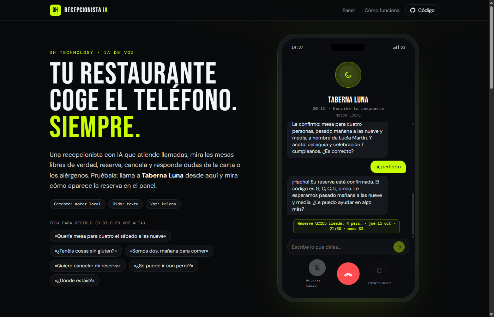
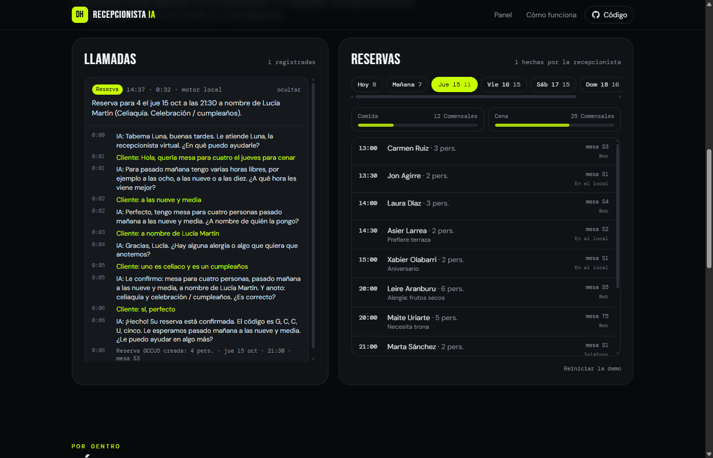

# Recepcionista IA

**Tu restaurante coge el teléfono. Siempre.** Una recepcionista de voz con IA que atiende llamadas, consulta mesas libres de verdad, reserva, cancela y responde dudas de la carta y los alérgenos.

**Pruébala: [dht-recepcionista.vercel.app](https://dht-recepcionista.vercel.app)**. Llama a Taberna Luna desde el navegador y mira cómo aparece la reserva en el panel del restaurante.



## Qué hace

- **Habla y escucha.** Pulsas llamar, suena el tono y la recepcionista te saluda. Le hablas como a una persona: «somos cuatro el sábado a las nueve, uno es celíaco».
- **Reserva de verdad.** Consulta la disponibilidad con las mismas reglas que el sistema de [Taberna Luna](https://github.com/hodeione/reservas-n8n): mesa libre todo el turno, mesa mínima según los comensales, ritmo de llegadas y antelación. Si no hay sitio, ofrece las horas más cercanas.
- **Cancela y cambia.** Entiende un código dictado letra a letra («erre, equis, siete…») o busca por nombre.
- **Responde dudas.** Horario, dirección, aparcamiento, terraza, mascotas, precios y alérgenos. Siempre con los datos del negocio, sin inventar nada.
- **Pasa la llamada a una persona** con los grupos grandes, cuando se lo piden o cuando no entiende.
- **Panel del dueño en vivo.** Cada llamada queda registrada con su transcripción, su resultado y un resumen. Las reservas entran con la mesa asignada.



## Cómo funciona

```
 micrófono ──► OÍDO ──► CEREBRO ──► herramientas ──► RESERVAS
                │          │                            │
   Web Speech o Whisper   Claude Haiku 5.5        mismo motor que
   (WebGPU, en local)     o motor local           reservas-n8n
                           │
                           └──► VOZ: frases en streaming ──► altavoz
```

| Pieza | Cómo |
|---|---|
| **Oído** | El reconocimiento de voz del navegador (texto en vivo) o **Whisper ejecutándose en tu equipo** con transformers.js y WebGPU: el audio no sale del navegador. Un detector de voz propio, con umbral adaptativo al ruido de fondo, decide cuándo has terminado de hablar. |
| **Cerebro** | **Claude Haiku 5.5** con cinco herramientas estrictas: `consultar_disponibilidad`, `crear_reserva`, `buscar_reserva`, `cancelar_reserva` y `colgar`. La función de Vercel solo reenvía la conversación; las herramientas se ejecutan en el navegador, contra las reservas. |
| **Motor local** | Sin clave o sin saldo, atiende un motor de diálogo propio: entiende fechas («el jueves de la semana que viene», «el diecisiete»), horas («las diez menos cuarto», «a la una»), comensales («cuatro adultos y dos niños», «mi mujer y yo») y nombres en castellano hablado. Es instantáneo y gratis. Si la IA falla a mitad de llamada, toma el relevo sin colgar. |
| **Voz** | **Voz realista con IA** que suena como una persona: ElevenLabs (Flash v2.5, ~75 ms) u OpenAI (`gpt-4o-mini-tts` con acento peninsular), a través de `/api/voz`. Cada frase se pide en cuanto Claude la escribe y la siguiente se descarga mientras suena la anterior. Sin clave, la síntesis del navegador. Horas, fechas y códigos se escriben para el oído. |

### Detalles de ingeniería

- **Streaming de punta a punta.** `/api/llamada` devuelve NDJSON: los fragmentos de texto según llegan y, al final, el mensaje completo con las llamadas a herramientas. El navegador agrupa el texto en frases y las va pasando a la voz.
- **Fecha sin errores.** Claude recibe una tabla con los próximos 14 días (`viernes 16/10 = 2026-10-16`), así no se equivoca al convertir «el viernes».
- **Conversación de solo añadir.** El historial (con los bloques de razonamiento intactos) vive en el navegador y se valida en el servidor: turnos alternos, tipos de bloque permitidos y tamaño máximo.
- **Barrera de gasto.** Límite por IP y global en la función, y detección de «sin saldo»: el servidor deja de intentarlo 10 minutos y la web pasa al motor local.
- **Conector n8n.** `src/lib/reservas/n8n.ts` habla con la [API de agentes de reservas-n8n](https://github.com/hodeione/reservas-n8n/blob/main/docs/openapi-agente.yaml), para conectar la recepcionista al sistema real del restaurante.
- **Comprobación de saldo.** `GET /api/llamada` hace una petición de un token (una millonésima de dólar) como mucho cada 10 minutos: si la cuenta no tiene saldo, la web empieza directamente con el motor local, y en cuanto se recarga, la IA se enciende sola.
- **115 pruebas** con Vitest: comprensión del castellano, motor de disponibilidad, conversaciones enteras con el motor local, el bucle de herramientas de Claude con una API simulada, el detector de voz con señales sintéticas, la firma de Twilio (con el ejemplo de su documentación) y llamadas telefónicas simuladas.

## Cuánto cuesta

| | Coste |
|---|---|
| Motor local | 0 € |
| Claude Haiku 5.5 (0,10 $ / 0,50 $ por millón de tokens) | **menos de 1 céntimo por llamada** |
| Voz realista (ElevenLabs Flash) | plan gratuito para probar; después, unos céntimos por llamada |
| Whisper y voz del navegador | 0 € |
| Teléfono (Twilio) | número español ~1-3 €/mes + ~1 cént./min |
| Alojamiento | Plan gratuito de Vercel |

## Ejecutarlo

```bash
npm install
npm run dev        # http://localhost:5173 (la función /api/llamada también funciona en local)
npm test           # 115 pruebas
npm run build
```

Variables de entorno (en local, exportadas antes de `npm run dev`; en Vercel, en *Settings → Environment Variables*). Sin ninguna, todo funciona con el motor local y la voz del navegador.

| Variable | Para qué |
|---|---|
| `ANTHROPIC_API_KEY` | Claude Haiku 5.5 como cerebro |
| `ELEVENLABS_API_KEY` | Voz realista (recomendada). `ELEVENLABS_VOZ` elige la voz: copia el ID de una voz de España de la biblioteca de ElevenLabs |
| `OPENAI_API_KEY` | Voz realista alternativa (`OPENAI_VOZ`, por defecto `coral`) |
| `VOZ_SECRETO` | Firma de los enlaces de audio que pide Twilio |
| `TWILIO_AUTH_TOKEN` | Activa la línea de teléfono y valida que las peticiones vienen de Twilio |
| `TELEFONO_EQUIPO` | Número al que pasar las llamadas que necesitan a una persona |
| `RESERVAS_N8N_URL`, `RESERVAS_N8N_CLAVE` | Sistema de reservas real de [reservas-n8n](https://github.com/hodeione/reservas-n8n) (si no, usa la ocupación de ejemplo) |

## Teléfono real con Twilio

La recepcionista también contesta un número de teléfono de verdad, sin servidor propio. Twilio transcribe lo que dice quien llama (`<Gather input="speech">`) y en cada turno llama a `/api/telefono`, que responde con el mismo motor que la web. La voz es la misma voz realista (`<Play>` de un enlace firmado a `/api/voz`), o la voz neuronal de Twilio si no hay clave. El estado de la llamada viaja comprimido en cookies, que Twilio conserva durante la llamada, y las reservas se guardan con el número de quien llama.

1. Crea una cuenta en Twilio y compra un número (los españoles piden documentación del negocio).
2. Añade `TWILIO_AUTH_TOKEN` en Vercel.
3. En el número, en *Voice → A call comes in*, pon `https://TU-DOMINIO/api/telefono` (POST).

## Estructura

```
api/llamada.ts                 Función de Vercel: un turno con Claude, en streaming
api/_lib/agente.ts             Instrucciones, ficha del negocio, herramientas y validación
api/voz.ts, api/_lib/voz.ts    Voz realista (ElevenLabs u OpenAI) y enlaces firmados
api/telefono.ts, api/_lib/telefono.ts   Línea de teléfono con Twilio (TwiML, firma, estado en cookies)
src/lib/es/                    Castellano hablado: números, fechas, horas, nombres, intenciones
src/lib/dialogo/local.ts       Motor de diálogo sin IA (máquina de estados)
src/lib/dialogo/claude.ts      Bucle de herramientas con Claude en el navegador
src/lib/reservas/              Motor de disponibilidad y conectores (local y n8n)
src/lib/voz/                   Micrófono, detector de voz, Whisper y síntesis
src/lib/llamada.ts             Orquesta la llamada: escuchar → pensar → hablar
src/worker.ts                  Whisper en un hilo aparte
```

---

Hecho por [DH Technology](https://h-com-bay.vercel.app). ¿La quieres en tu negocio? Hablemos. Taberna Luna es un restaurante de demostración.

Licencia MIT.
